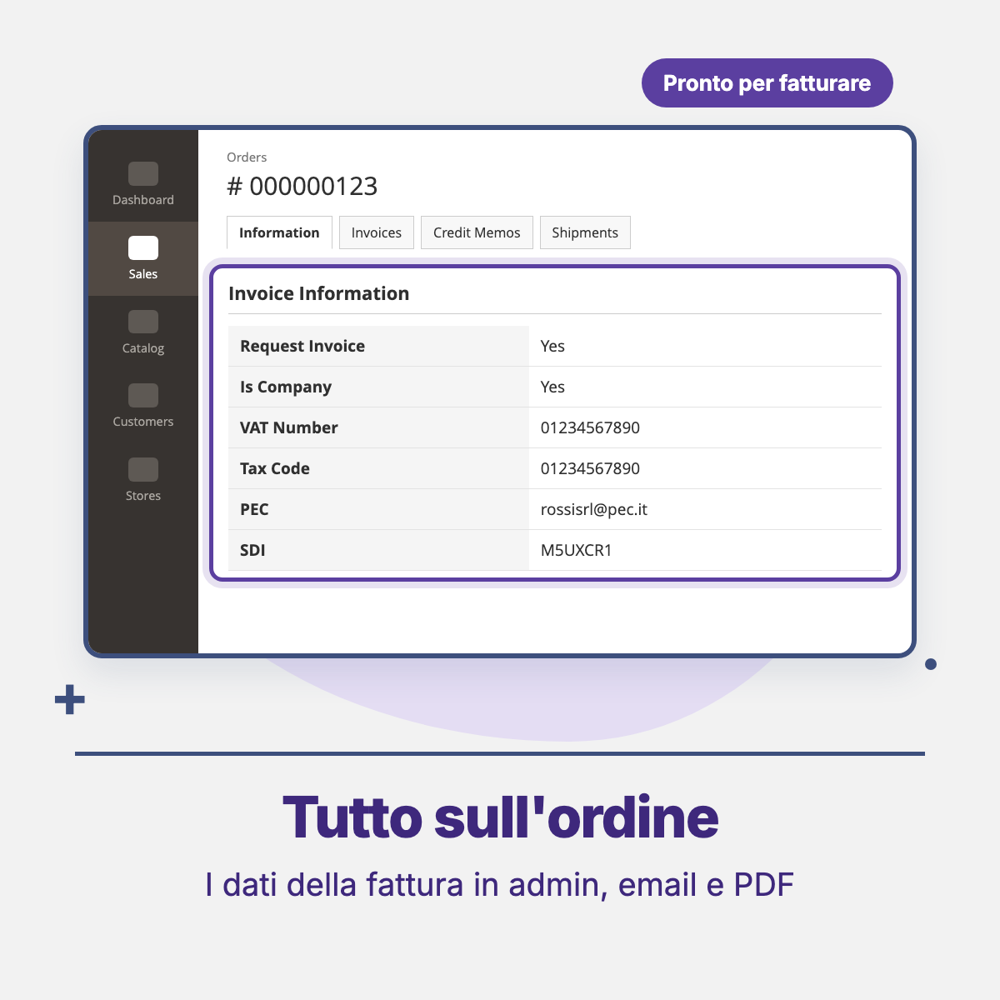

# Threecommerce_ItalianInvoice: Italian invoice request for Magento 2 / Mage-OS

**Italian invoice request** for Magento 2 and Mage-OS: adds to the billing address the fields *Request invoice*, *Company / Individual*, *Codice Fiscale*, *PEC* and *SDI recipient code* (besides the native Company and VAT number), validates them on the server, stores them on quote and order and shows them in the admin order.

**Compatibility:** Magento Open Source / Adobe Commerce 2.4.4+ · Mage-OS 3.x · PHP 8.1 – 8.4 · Checkout: Luma, Breeze and Hyvä (with the Threecommerce one-step checkout)
**License:** commercial · coming soon

## Features

- Billing fields: request invoice, company or individual, Codice Fiscale, PEC, SDI code. Company name and VAT number use the native `company` and `vat_id` fields.
- **Server-side validation** when the customer requests an invoice:
  - individual: Codice Fiscale required, 16 characters with check character (omocodia allowed);
  - company / professional: VAT number required, 11 digits with check digit (`IT` prefix and spaces removed), Codice Fiscale optional;
  - PEC (optional): valid email address;
  - SDI (optional): 7 alphanumeric characters (6 for public administration office codes).
  - Italian rules apply only when the billing country is Italy.
- Checks run on payment placement (logged-in and guest, readable REST error in the checkout) and on quote submission, so every channel is covered, including GraphQL and admin orders.
- Data saved on `quote_address` and `sales_order_address`, with matching attributes on customer addresses.
- Invoice data shown in the **Invoice Information** box of the admin order.
- Fields in the My Account address form; optional VAT number field in the customer registration form.
- Address template snippet to print invoice data in addresses.
- "Enable Module" switch: when off the module is inert and core templates are used.
- Italian translation included.

## Requirements

- Magento Open Source / Adobe Commerce 2.4.4+ or Mage-OS
- PHP 8.1 – 8.4
- Package: `threecommerce/m2-base`

## Availability

This module is **not yet available for purchase**. See the [product page](https://www.threecommerce.it/richiesta-fattura-elettronica-magento-2?utm_source=github&utm_medium=readme&utm_campaign=magento2-italian-invoice) for the current status, or [get in touch](https://www.threecommerce.it/contatti?utm_source=github&utm_medium=readme&utm_campaign=magento2-italian-invoice) to be notified when it is released or to ask for details.

## Configuration

Admin → **Stores → Configuration → Threecommerce Plugins → Italian Invoice**: enable the module, show the VAT number field in the registration form, and the address template snippet to paste into Customer → Address Templates.

## Documentation and support

- Product page: [threecommerce.it/richiesta-fattura-elettronica-magento-2](https://www.threecommerce.it/richiesta-fattura-elettronica-magento-2?utm_source=github&utm_medium=readme&utm_campaign=magento2-italian-invoice)
- [Changelog](CHANGELOG.md) (in Italian)
- Questions and custom development: [threecommerce.it/contatti](https://www.threecommerce.it/contatti?utm_source=github&utm_medium=readme&utm_campaign=magento2-italian-invoice)

---

*This repository is the public showcase of the module. The source code is kept in a private repository.*
